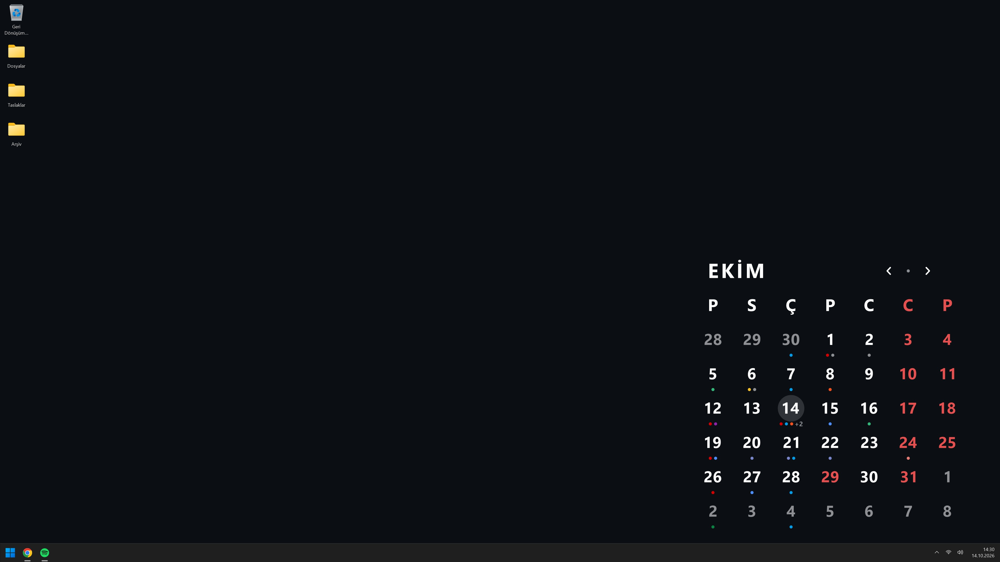
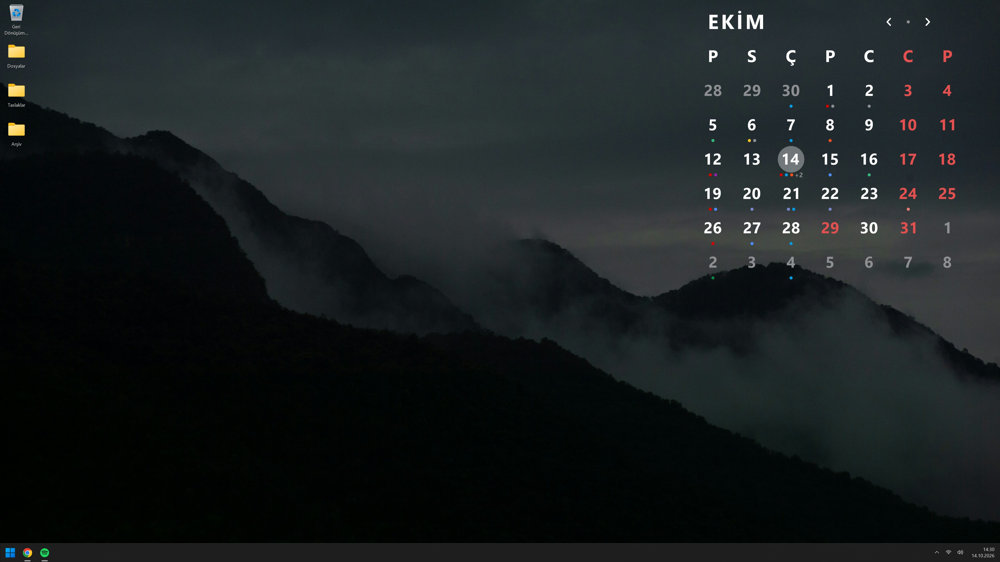
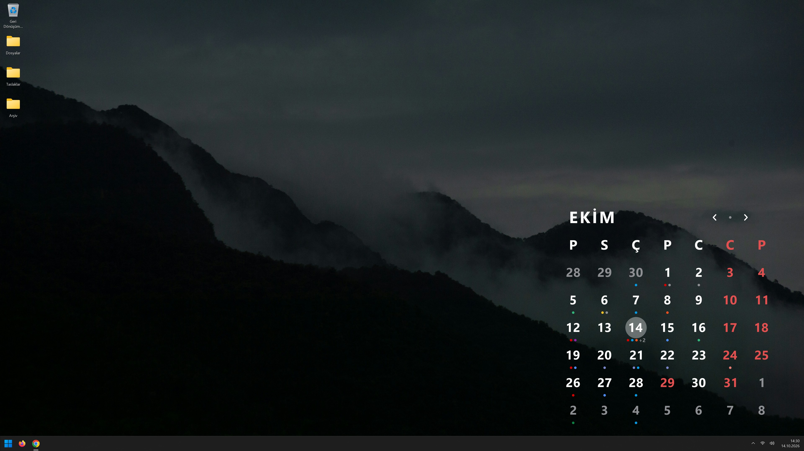
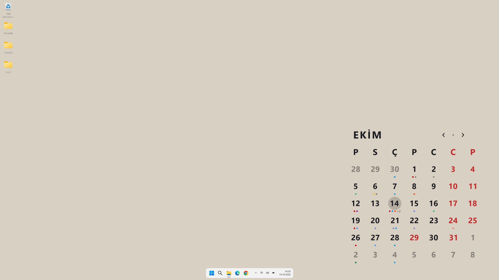
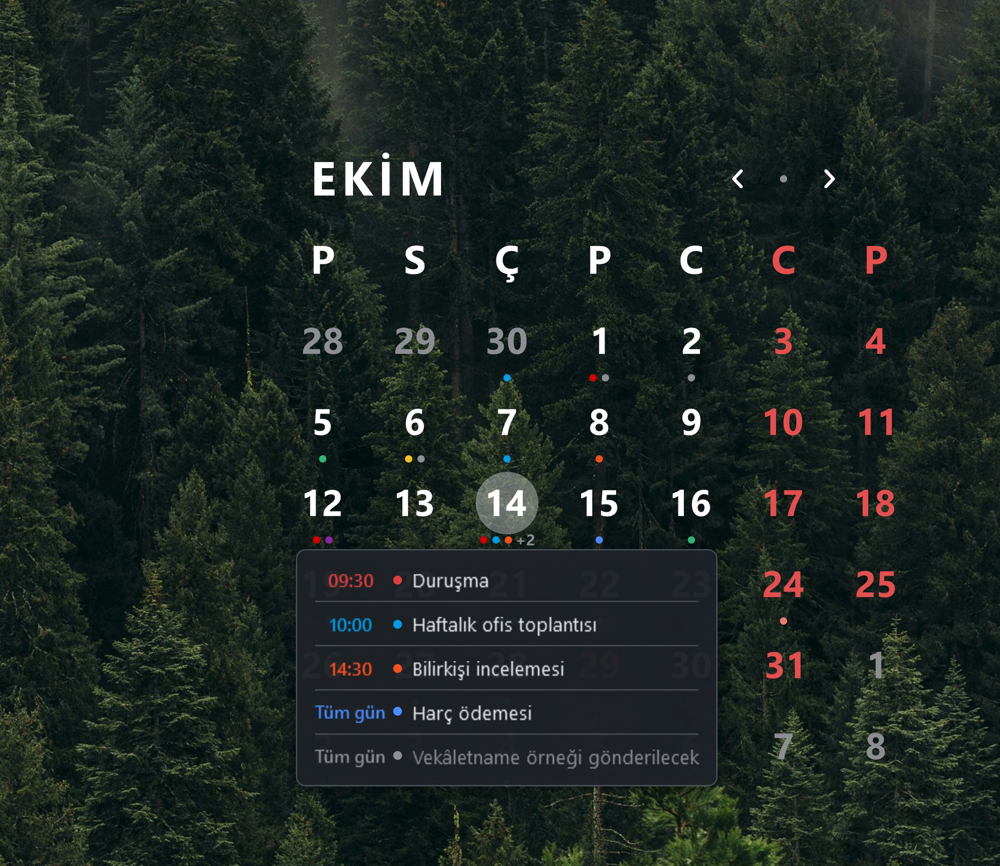

# Kalender

### [⬇ Windows için indir (Kalender-Kurulum.exe)](https://github.com/SCgrS/Kalender/releases/latest/download/Kalender-Kurulum.exe)

Duvar kâğıdının bir parçası olarak çizilen aylık bir **masaüstü takvimi**.

Ortada pencere olmadığı için masaüstünde klasör açmak, simge sürüklemek ya da seçim yapmak hiç etkilenmez. Bir günün
üzerinde kısa süre beklediğinizde o günün Google Takvim etkinlikleri ve görevleri küçük bir kutuda listelenir. Google
hesabına yalnızca okuma izniyle bağlanılır.

Takvim konumu, boyutu ve renkleri özelleştirilebilir.

## Kurulum

Windows 10 (20H2 ve üzeri) ya da Windows 11, 64 bit.

1. Yukarıdaki bağlantıdan `Kalender-Kurulum.exe` dosyasını indirin ve çift tıklayın.
2. Windows SmartScreen uyarı gösterirse **Daha fazla bilgi**'ye, sonra **Yine de çalıştır**'a basın.
3. **Kur**'a basın. Kurulum birkaç saniye sürer, ardından Kalender başlar.

Google Takvim ve Görevler bağlantısı adımları aşağıda, **Google Takvim ve Görevler Bağlantısı** başlığındadır.

## Öne çıkanlar

- **Duvar kâğıdının parçası:** Takvim pencere değil, duvar kâğıdının bir parçasıdır. Masaüstündeki simgeler ve seçimler hiç
  etkilenmez.
- **Google Takvim ve Görevler:** Gün rakamının altında o güne düşen etkinlik ve görevler için renkli noktacıklar çıkar. Bir
  günün üzerinde beklediğinizde o günün tatili, etkinlikleri ve görevleri listelenir.
- **Resmî tatiller:** Pazar günleri, isteğe bağlı olarak cumartesiler ve resmî tatiller kırmızı görünür.
- **Ay düğmeleri:** Ay adının yanındaki **‹ • ›** düğmeleriyle aylar arasında gezilir.
- **Zemin:** Düz renk, uygulamayla gelen dört fotoğraftan biri ya da kendi fotoğrafınız olabilir.
- **Birden çok monitör:** Konum, boyut ve fotoğraf her monitör için ayrı ayarlanır.

## Ne yapar

Görüntülerdeki etkinlik ve görevler örnektir.

### Masaüstündeki takvim

Takvim duvar kâğıdının bir parçası olarak çizilir. Zemin düz renk, uygulamayla gelen dört fotoğraftan biri ya da kendi
fotoğrafınız olabilir.

### Gün kutusu

Fareyi bir günün üzerinde kısa süre tutunca o günün kayıtları saat sırasıyla listelenir. Her
satırın rengi Google'daki rengiyle aynıdır, tamamlanmış görevler gri görünür.

### Ay düğmeleri

Ay adının sağındaki **‹** bir ay geri, **›** bir ay ileri gider. Aradaki **•** bu aya döner.
Başka bir aydayken takvime 30 saniye dokunulmazsa takvim kendiliğinden bu aya döner. Takvimin
üzerine sağ tıklayınca da aylar arasında gezebilir ya da o günü Google Takvim'de açabilirsiniz.
Takvimin üstündeki masaüstü simgelerine tıklamak simgeye gider.

### Resmî tatiller

Tatil listesi Google'ın Türkiye resmî tatil takviminden alınır ve 30 günde bir yenilenir. Listedeki
Ramazan ve Kurban bayramları 2035'e kadar Diyanet'in tarihleriyle gösterilir. Tam gün
tatiller kırmızıdır. Arifelerin adı yalnızca gün kutusunda görünür. Listeyi hemen yenilemek
için tepsi menüsündeki **Şimdi yenile**'ye basın.

> Dinî bayram tarihleri idari kararla değişebilir. Lütfen resmî kaynaklardan teyit ediniz.

### Ayarlar

Saatin yanındaki tepsi simgesine tıklayın. Her değişiklik anında masaüstüne uygulanır.

- **Arka plan:** Hazır renkler, kendi renginiz, dört hazır fotoğraf ya da kendi fotoğrafınız.
- **Renkler:** Yazı, tatil ve bugün renkleri, cumartesinin kırmızı olup olmayacağı, gün kutusunun
  opaklığı.
- **Boyut ve Konum:** Takvimin hangi ekranlarda görüneceği, yeri (sürükleyerek) ve boyutu.
- **Google:** Hesap bağlantısı (aşağıda).
- **Genel:** Windows açılışında başlatma, güncelleme denetimi, Kalender'i kaldırma.

Tepsi simgesine sağ tıklayınca **Şimdi yenile**, **Takvimi gizle**, **Eski duvar kâğıdıma dön**
ve **Çıkış** gibi komutlar çıkar.

## Google Takvim ve Görevler Bağlantısı

Kalender Google hesabınıza **yalnızca okuma** izniyle bağlanır. Etkinlik veya görev eklemez,
silmez. Bağlantı doğrudan sizinle Google arasındadır, arada başka bir sunucu yoktur. Bunun için
kendi Google Cloud istemci kimliğinizi oluşturmanız gerekir (bir kerelik, yaklaşık beş dakika).
Aynı adımlar Ayarlar penceresinde **Client ID nasıl alınır?** başlığı altında da yazılıdır.

### 1. Google Cloud projesi oluşturun

1. [console.cloud.google.com](https://console.cloud.google.com) adresine Google hesabınızla girin.
2. Üstteki proje seçicisine (Google Cloud yazısının sağındaki açılır kutu) tıklayın, **Yeni
   proje**'ye basın, ada `Kalender` yazıp **Oluştur**'a basın. Sonra seçiciden bu projeyi seçin.

### 2. İki API'yi açın

1. Sol menüden **API'ler ve Hizmetler > Kitaplık**'a girin.
2. Arama kutusuna `Google Calendar API` yazın, sonuca tıklayın, **Etkinleştir**'e basın.
3. Kitaplığa dönüp `Google Tasks API` arayın, onu da **Etkinleştir**'e basın.

### 3. İzin ekranını hazırlayın

Sol menüden **API'ler ve Hizmetler > OAuth izin ekranı**'na girin. Google sizi **Google Auth
Platform** sayfasına yönlendirir.

1. **Get started**'a basın.
2. **App Information**: Uygulama adı `Kalender`, destek e-postası kendi adresiniz → **Next**.
3. **Audience**: **External** → **Next**. **Contact Information**: E-posta adresiniz → **Next**.
4. **Finish**: İlkeyi kabul eden kutuyu işaretleyin → **Continue** → **Create**.
5. Sol menüden **Branding**'e girin. **Application home page** ve **Application privacy policy
   link** kutularına `https://github.com/SCgrS/Kalender` yazın. **Authorized domains** altında
   **+ Add domain** ile `github.com` ekleyip **Save**'e basın. Logo eklemeyin, logo Google'ın
   uygulamayı ayrıca incelemesini gerektirir.
6. Sol menüden **Audience**'a girip **Publish app** → **Confirm**'e basın. Durum **In
   production** olur. Yayımlamazsanız uygulama **Testing** durumunda kalır. O zaman kendinizi
   **Test users** bölümüne eklemeniz gerekir ve Google bağlantıyı 7 günde bir düşürür.

### 4. İstemci kimliğini oluşturun

1. Sol menüden **Clients** → **+ Create client**.
2. Application type: **Desktop app**. Ad: `Kalender` → **Create**.
3. Çıkan pencerede **Client ID** ve **Client secret** yazar. İkisini de kopyalayın. Pencereyi
   kapatsanız bile Clients listesinden yeniden açabilirsiniz.

### 5. Kalender'e yapıştırın

1. Tepsi simgesine tıklayıp **Ayarlar**'ı açın, soldan **Google** sayfasına geçin.
2. İki değeri **İstemci kimliği (Client ID)** ve **İstemci gizli anahtarı (Client secret)**
   kutularına yapıştırın.
3. **Google'a bağlan**'a basın. Tarayıcıda Google onay ekranı açılır.
4. "Google bu uygulamayı doğrulamadı" uyarısı çıkarsa **Gelişmiş > Kalender'e git (güvenli
   değil)** yolunu izleyin. Uygulama Google'ca incelenmediği için bu uyarı beklenen bir durumdur.
5. İzin verince tarayıcıda "Kalender bağlandı" yazısını görürsünüz. Sekmeyi kapatabilirsiniz.

Bağlanırken durum satırının yanında dönen bir çember görünür. Önce tarayıcıdaki onay beklenir,
sonra takvimler ve görevler ilk kez alınır. Bu birkaç saniye sürebilir. Bekleyişi bırakmak için
aynı düğmeye (**Vazgeç**) basın. Bir sorunla karşılaşırsanız **Bağlantıyı kes**'e basın,
ardından **Google'a bağlan** ile yeniden bağlanıp bir süre bekleyin.

Bağlandıktan sonra aynı sayfada **Ne sıklıkla yenilensin?** (30 saniye – 24 saat),
**Gösterilecek takvimler**, **Gösterilecek görev listeleri** ve **Görev noktacığı rengi**
seçenekleri açılır. **Bağlantıyı kes** yetki dosyasını ve bilgisayardaki veri kopyasını siler.

Google izni geçersiz sayarsa (izni geri aldıysanız ya da uygulama hâlâ **Testing**
durumundaysa) Kalender bağlantıyı keser ve tepside bir uyarı gösterir. **Google'a bağlan** ile
yeniden bağlanın.

## Güncelleme

Kalender yeni sürümleri kendisi bulur ve bir pencereyle haber verir. **Güncelle**'ye basmanız
yeter. Ayarlarınız ve Google bağlantınız güncellemede korunur. Güncelleme denetimi **Ayarlar > Genel**'den kapatılabilir.

## Kaldırma

**Ayarlar > Genel > Kalender'i kaldır** ya da Windows **Ayarlar > Uygulamalar** listesinden
**Kaldır**. Kaldırma, Kalender'den önceki duvar kâğıdınızı geri yükler. **Ayarlarımı ve yerel
veri kopyamı da sil** kutusunu işaretlemezseniz yeniden kurduğunuzda her şey yerinde olur.

## Verileriniz

Kalender telemetri içermez, hiçbir veri toplamaz. Google hesabınıza yalnızca okuma izniyle bağlanır. Bağlantı doğrudan sizinle
Google arasındadır. Görünen ayın etkinlik ve görevlerinin başlık ve tarihleriyle bir kopyası, internet yokken de gösterilebilsin
diye bilgisayarınızda durur. **Bağlantıyı kes** bu kopyayı da siler. Kalender internete bunun dışında yalnızca resmî tatil
listesini yenilemek ve yeni sürüm olup olmadığına bakmak için bağlanır.

## Üçüncü taraf bileşenler

Kalender hiçbir üçüncü taraf pakete bağlı değildir. Kullandığı her şey Microsoft'un .NET'i ve Windows'un kendisidir. Hazır
fotoğrafların sahipleri ve lisansları [UCUNCU-TARAF.md](UCUNCU-TARAF.md) dosyasındadır.

## Teşekkür

Uygulamayla gelen zemin fotoğraflarını Unsplash'te herkesle paylaşan Dan Otis, Chris wu, Patrick Carr ve Artur Adilkhanian'a
teşekkür ederim.

---

Soru ve geri bildirimler için: [x.com/CgrShn](https://x.com/CgrShn)
