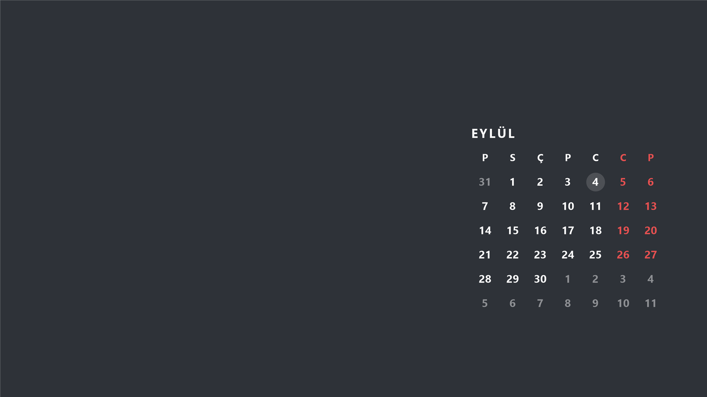

# Kalender

Windows masaüstünde, duvar kağıdının üstüne ama masaüstü simgelerinin altına çizilen aylık
takvim. Takvim duvar kağıdının bir parçasıymış gibi görünür: üzerine klasör koyabilir,
tıklayabilir, sürükleyerek çoklu seçim yapabilirsiniz — takvim hiçbir şeye karışmaz.

Günlerin üzerine gelince, Windows'un kendi ipucu balonları tarzında küçük bir kutu açılır ve
o günün Google Takvim etkinlikleri ile görevleri listelenir.



## Ne yapar

- Aylık takvimi doğrudan masaüstü katmanına (WorkerW) çizer; ayrı bir pencere açmaz.
- Pazar günleri, isteğe bağlı olarak cumartesiler ve resmi tatiller kırmızı gösterilir.
- Gün rakamının altında, o güne düşen etkinlikler için küçük renkli noktacıklar çıkar.
- Fareyle bir günün üzerinde kısa süre beklediğinizde o günün etkinlikleri ve görevleri listelenir.
- Zemin düz renk ya da kendi fotoğrafınız olabilir; her monitör için ayrı ayarlanabilir.
- Seçilen zemin aynı zamanda Windows duvar kağıdına da yazılır; böylece açılışta Kalender
  devreye girene kadar ekran farklı görünmez.

## Gereksinimler

- Windows 10 (20H2 ve üzeri) veya Windows 11
- 64 bit (x64) işlemci
- Kurulum için yönetici hakkı **gerekmez**

## Kurulum

> Bu bölüm ilk sürüm yayımlandığında doğrudan indirme bağlantısıyla güncellenecektir.

1. `Kalender-Kurulum.exe` dosyasını indirin.
2. Çift tıklayın.
3. Dosya imzalı olmadığı için Windows SmartScreen bir uyarı gösterebilir:
   **Daha fazla bilgi** yazısına tıklayın, sonra çıkan **Yine de çalıştır** düğmesine basın.
4. Kurulum `%LOCALAPPDATA%\Kalender` klasörüne yapılır, Başlat menüsüne kısayol eklenir ve
   Windows açılışında kendiliğinden başlaması ayarlanır.

## Google Takvim ve Görevler bağlantısı

Kalender, Google hesabınıza **yalnızca okuma** izniyle bağlanır; etkinlik veya görev eklemez,
silmez. Bağlantı için kendi Google Cloud istemci kimliğinizi oluşturmanız gerekir. Böylece
verileriniz doğrudan sizin Google hesabınızla Kalender arasında kalır, arada başka bir
sunucu olmaz.

> Bu rehber, Google bağlantısı eklendiğinde (4. aşama) adım adım doldurulacaktır.

## Ayarlar

Tepsi (saatin yanındaki bildirim alanı) simgesine **tıklayın** ya da sağ tıklayıp
**Ayarlar**'ı seçin. Kalender zaten açıkken `Kalender.exe`'yi tekrar çalıştırmak da
ayarları açar.

Yaptığınız her değişiklik anında masaüstüne yansır; "Tamam"a basmanız gerekmez.

### Zemin

- **Hazır renkler** — koyudan açığa sekiz renk. Birine tıklayın, hemen uygulanır.
- **Kendi rengim** — renk çarkından ton ve doygunluk, yandaki şeritten parlaklık
  seçilir. Renk kodunu (`#2E3238` gibi) elle de yazabilirsiniz.
- **Fotoğraf** — kendi resminizi zemin yapar. Yerleşim seçenekleri: Kapla, Sığdır,
  Ortala, Döşe.

Seçtiğiniz zemin aynı zamanda Windows duvar kağıdına da yazılır; böylece açılışta
Kalender devreye girene kadar ekran farklı görünmez. Bunu geri almak için tepsi
menüsündeki **Eski duvar kağıdıma dön**'ü kullanın.

### Yazı

- **Yazı rengini zemine göre otomatik seç** — düz renk zeminde açık/koyu yazı
  kendiliğinden seçilir. Fotoğraf zeminde otomatik seçim yapılamaz, rengi siz
  belirlersiniz.
- **Cumartesi de pazar gibi kırmızı olsun** — varsayılan olarak açık.
- **Takvimin arkasını karart** — yalnızca fotoğraf zeminde. Yazılar okunmuyorsa
  takvimin arkasına yumuşak bir gölge koyar.

### Ekranlar

- Takvimin **tüm ekranlarda**, **yalnız ana ekranda** ya da **seçtiğiniz
  ekranlarda** görünmesini seçebilirsiniz.
- Her ekran için ayrı ayrı:
  - **Takvimi taşı** — o ekranı kaplayan bir yerleştirme ekranı açar. Takvimi
    sürükleyip bırakın; kenarlara ve ortaya yaklaşınca kendiliğinden hizalanır.
    Aynı ekranda boyutu da (%80-150) ayarlayabilirsiniz. Esc: vazgeç.
  - **Boyut** — takvimin büyüklüğü.
  - **Bu ekrana fotoğraf…** — o ekrana özel zemin fotoğrafı.

Konum, boyut ve fotoğraf her monitör için ayrı hatırlanır. Ekranlarınızın
çözünürlüğü ya da ölçeği değişirse Kalender kendini yeniden kurar.

## Resmi tatiller

Tatil listesi Google'ın herkese açık Türkiye resmi tatil takviminden (ICS) alınır; hesap
ya da anahtar gerekmez. Liste bilgisayarınızda `%LOCALAPPDATA%\Kalender\cache` altında
saklanır ve ayda bir yenilenir. İnternet olmadığında en son indirilen liste sessizce
kullanılmaya devam eder, hata penceresi çıkmaz.

- **Tam gün resmi tatiller** kırmızı gösterilir.
- **Arifeler (yarım günler)** kırmızı gösterilmez, normal gün gibi durur. Adları gün
  kutusunda görünür (5. aşamada).
- **Anneler Günü gibi kutlama/anma günleri** tatil sayılmaz, kırmızıya boyanmaz.

Listeyi elle yenilemek için tepsi menüsünde **Şimdi yenile** ya da Ayarlar penceresindeki
**Listeyi şimdi güncelle** düğmesi.

> **Uyarı:** Dini bayram tarihleri idari kararla değişebilir; lütfen resmi kaynaklardan
> teyit ediniz.

## Kaldırma

`Kalender-Kaldir.exe` dosyasını çalıştırın (ya da Ayarlar penceresindeki **Kaldır**
düğmesini kullanın). Kaldırma sırasında:

- Kalender kurulmadan önceki duvar kağıdınız geri yüklenir,
- Ayar ve önbellek klasörünün silinip silinmeyeceği sorulur.

## Şu anki durum

Proje aşama aşama geliştiriliyor.

| Aşama | İçerik | Durum |
| --- | --- | --- |
| 1 | İskelet, WorkerW katmanı, düz renk zemin, statik takvim çizimi | Tamam |
| 2 | Çoklu monitör, DPI, konum/boyut, temalar, renk seçici, fotoğraf | Tamam |
| 3 | Resmi tatil listesi (ICS), önbellek, kırmızı günler | Tamam |
| 4 | Google OAuth, takvim ve görev çekme, artımlı yoklama | Sırada |
| 5 | Noktacıklar, fare üstünde açılan gün kutusu | Bekliyor |
| 6 | Ayarlar penceresi, tepsi menüsü, açılışta başlatma | Bekliyor |
| 7 | Kurulum dosyası, README, sürüm etiketi | Bekliyor |

## Sürüm geçmişi

### 0.3.0 (geliştirme)

- Resmi tatiller Google'ın açık ICS akışından indiriliyor, yerel olarak saklanıyor ve
  ayda bir yenileniyor. İnternet yoksa önbellek sessizce kullanılıyor.
- Tam gün tatiller kırmızı; arifeler normal, kutlama/anma günleri hariç.
- Ayarlara "Resmi tatiller" bölümü ve dini bayram teyit uyarısı eklendi.
- Tepsi menüsündeki "Şimdi yenile" artık çalışıyor.

### 0.2.0 (geliştirme)

- Görünüm ayarları penceresi: hazır renkler, renk çarkı, fotoğraf zemin, yazı rengi,
  cumartesi rengi, takvim arkası karartma.
- Takvim sürükleyerek yerleştirilebiliyor; kenarlara ve ortaya yapışıyor.
- Konum, boyut ve fotoğraf her monitör için ayrı hatırlanıyor.
- Ekran ölçeği (DPI), çözünürlük, monitör tak/çıkar, uzak masaüstü ve kilit açma
  durumlarında katman kendini yeniden kuruyor.
- Takvimin boyutu ekran ölçüsüyle orantılı: çözünürlük değişince takvim de
  birlikte küçülüp büyüyor, ekrandaki oranı sabit kalıyor.

### 0.1.0 (geliştirme)

- İlk iskelet: masaüstü katmanı, düz renk zemin, aylık takvim çizimi, tepsi simgesi.

## Geliştirme

```
dotnet build Kalender.sln -c Debug
```

Tek dosya, kendi kendine yeten yayın için:

```
powershell -ExecutionPolicy Bypass -File yayin.ps1
```

Belirli bir ayın takvimini arayüz açmadan bir PNG'ye çizdirmek için (görünüm ve tatil
denetimlerinde işe yarıyor):

```
Kalender.exe --onizleme 2026-10 C:\gecici\ekim.png
```

Kullanılan üçüncü taraf bileşenler için [UCUNCU-TARAF.md](UCUNCU-TARAF.md) dosyasına bakın.
